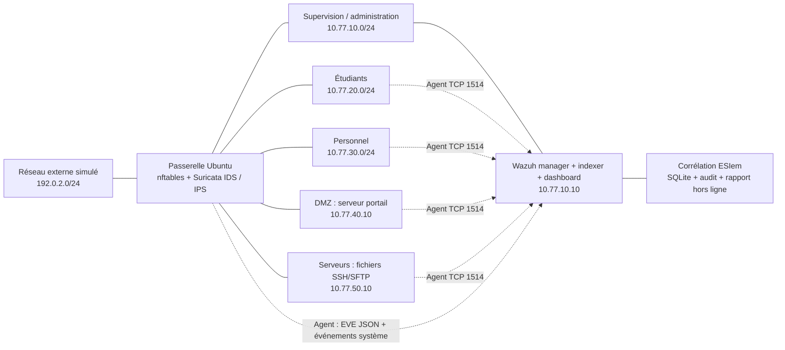

# ESIem

**Adaptation de Wazuh à un réseau universitaire segmenté : collecte hôte et réseau, corrélation d’alertes, priorisation et réponse temporaire encadrée.**

Projet de laboratoire inspiré d’un travail réalisé en deuxième année du cycle supérieur à l’ESI. L’architecture est **reconstituée à partir des souvenirs du porteur du projet** ; elle ne décrit pas l’infrastructure réelle de l’école. Aucun accès au réseau de l’université n’est nécessaire.

## État vérifiable

Le projet a été exécuté et corrigé à partir de tests natifs, pas uniquement d’une validation des fichiers de configuration.

| Vérification | Résultat | Preuve |
|---|---:|---|
| Tests Python, dont isolation des clés entre agents | 24 réussis | Suite `tests/` et workflow `ci.yml` |
| Scénarios de régression synthétiques | 16/16 | [Résultats](reports/regression.json) |
| Règles et décodeurs dans le vrai `wazuh-logtest` | 5/5 | [Rapport](reports/wazuh-integration.json) |
| Pile Wazuh, agent, intégrité, corrélation et indexation | 14/14 | [Rapport](reports/stack-acceptance.json) |
| Paquets réels : segmentation, IDS, IPS et isolation de 300 s | 19/19 | [Rapport CI](reports/network-acceptance.json) |
| Même recette réseau dans une VM VirtualBox | 19/19 | [Rapport local](reports/virtualbox-network-acceptance.json) |
| Pile complète dans la VM SOC compacte, 3 712 Mio | 14/14, aucun OOM observé | [Recette](reports/compact-stack-acceptance.json), [mémoire](reports/compact-resources.json) |

Les tests réseau utilisent des marqueurs HTTP inoffensifs. La recette SIEM combine des lignes SSH synthétiques, une vraie modification de fichier et le rejeu d’événements EVE capturés lors des tests de paquets. **Ces résultats ne mesurent pas un taux de détection d’attaques réelles.** Les zones réseau sont des namespaces Linux dans la recette automatisée ; la pile Wazuh et son agent sont de vrais services en conteneurs.

Les sept disques de VM sont préparés sur le PC de développement ; les VM SOC et passerelle ont réellement démarré. Les sept VM n’ont pas été exploitées ensemble. Les limites de mémoire et l’incident de noyau local, suivi d’une recette réussie, sont documentés dans [la validation](docs/VALIDATION_FR.md).

## Architecture



Deux serveurs de service, deux postes, une passerelle et un hôte SOC. Un poste d’administration peut être une VM séparée ou un poste raccordé au réseau de supervision. Les composants centraux Wazuh sont séparés en conteneurs sur le même hôte SOC ; cette version **n’est pas un cluster à haute disponibilité**.

## Travail propre au projet

- Plan d’adressage, filtrage entre cinq zones, protection contre l’usurpation d’adresse et chaîne IPS distincte du filtrage.
- Génération depuis **Wazuh 4.14.10** : sources officielles vérifiées par SHA-256, mots de passe aléatoires cohérents entre composants, utilisateurs de démonstration retirés, enrôlement réseau fermé, interface et API limitées à l’hôte.
- Collecte centralisée : authentification SSH, audit Linux, intégrité des fichiers sensibles, EVE Suricata et configuration optionnelle des événements Windows/Sysmon.
- Extensions des règles Wazuh sans écraser les règles éditeur ; deux marqueurs HTTP inoffensifs servent à tester la différence entre détection et blocage. Les règles ET Open sont téléchargées sur la VM par Suricata-Update.
- Moteur de corrélation : tentatives répétées par source/compte/hôte, connexion après échecs, connexion suivie d’un changement sensible, rapprochement entre observations réseau et hôte. La criticité de la destination intervient dans la priorité.
- Transactions SQLite, déduplication, reprise après redémarrage, événements retardés dans une fenêtre bornée, chaîne d’audit et vérification de cohérence avec les incidents.
- Réponse optionnelle : isolation de cinq minutes dans un ensemble nftables dédié, uniquement pour une plage de postes du laboratoire ; simulation par défaut.
- Rapport HTML autonome, filtres de priorité et références aux preuves. Aucun service d’analyse externe ni bibliothèque JavaScript distante.

Wazuh fournit déjà la collecte, les décodeurs standard, de nombreuses détections, l’inventaire, la SCA et le stockage/indexage. Ce projet les configure et les étend ; il ne prétend pas avoir réécrit ces fonctionnalités. La détection des vulnérabilités est initialement désactivée dans le générateur jusqu’à validation des flux sortants et du dimensionnement.

## Essai immédiat sans VM

Python 3.12 ou plus récent. Depuis la racine du projet :

```sh
python -m unittest discover -v
python tools/evaluate.py
python -m campus ingest tests/demo-alerts.jsonl --db runtime/demo.db
python -m campus report --db runtime/demo.db --output runtime/demo.html
python -m campus audit --db runtime/demo.db
```

Ouvrir `reports/demo.html` pour le rapport de démonstration déjà généré. Ces événements sont **synthétiques**, au format des alertes Wazuh. Il n’y a ni entraînement de modèle ni score de précision sur des attaques réelles. Les cas attendus sont définis à part dans `tests/fixtures.py` et les résultats dans `reports/regression.json`.

Le rapport `reports/validated-incidents.html` présente les incidents issus de la recette native du SIEM, avec leur provenance de laboratoire. Les liens de campagne et les résultats sont conservés dans les rapports JSON versionnés.

## Préparer les VM

Sur la machine de préparation ou le futur hôte SOC :

```sh
python -m venv .venv
# Linux : source .venv/bin/activate
# Windows PowerShell : .\.venv\Scripts\Activate.ps1
python -m pip install -r requirements.txt
python -m campus preflight
python tools/render_network.py
python -m campus prepare --manager-bind 10.77.10.10
```

`prepare` refuse d’écraser un déploiement existant. Les mots de passe, clés, volumes, bases d’incidents et fichiers réseau générés sont exclus de Git. Ils ne doivent pas être publiés.

Le SOC exige au minimum 4 vCPU, 8 Gio de RAM et 50 Go de stockage selon [Wazuh](https://documentation.wazuh.com/current/deployment-options/docker/wazuh-container.html). Le laboratoire complet est dimensionné ici pour un hôte d’au moins 24 Gio de RAM et environ 180 Go libres, idéalement 32 Gio de RAM. Ce budget est une proposition de laboratoire, pas une mesure de charge. Ne pas confondre taille virtuelle d’un disque et espace libre sur l’hôte physique.

Suivre [le guide de déploiement](docs/DEPLOYMENT_FR.md), puis [la recette](docs/ACCEPTANCE_FR.md). Docker Compose 2.30 ou plus récent est nécessaire pour le contrôle de permissions des groupes après démarrage. Le port d’enrôlement distant reste fermé ; le service local d’enrôlement fonctionne pour maintenir la cohérence de la base d’agents.

Le profil VirtualBox et les scripts de préparation sont décrits dans [ce guide](docs/VIRTUALBOX_FR.md). Un profil compact optionnel, avec plafonds de mémoire, se trouve dans `config/compose.compact.yml` : il a passé la recette dans une VM de 3 712 Mio avec un agent de test plafonné à 256 Mio. Cet essai à faible charge ne remplace pas le dimensionnement officiel à 8 Gio. Pour reprendre la démonstration locale, voir [les instructions de reprise](docs/DEMO_LOCALE_FR.md).

## Organisation

| Dossier | Contenu |
|---|---|
| `campus/` | Corrélation, audit, génération sécurisée, rapport et réponse optionnelle |
| `wazuh/` | Règles locales et configurations centralisées des agents |
| `infra/` | Passerelle, règles Suricata, audit Linux et serveur portail |
| `config/` | Actifs, topologie, politique de réponse et rétention |
| `tools/` | Inventaire, contrôles, recette native Wazuh, ingestion et génération réseau |
| `tests/` | Tests automatisés et événements synthétiques identifiés |
| `vendor/wazuh-docker/` | Petits fichiers officiels non modifiés, licence et manifeste de provenance |
| `docs/` | Installation, limites, méthode et procédure d’exploitation |

## Limites et attribution

La corrélation est conçue pour un petit laboratoire et utilise des seuils explicites. Elle ne remplace pas un moteur distribué de production. Le trafic chiffré n’est pas déchiffré par Suricata. Un succès SSH après échecs ou une association temporelle ne prouve pas une compromission. La chaîne d’audit nécessite une empreinte conservée hors de l’hôte pour résister à une réécriture complète.

Le développement a bénéficié d’une assistance IA. Les résultats exécutés et les éléments restant à valider sont distingués dans la documentation. Ne présenter en entretien que les expériences réellement réalisées et comprises.

Licence : GPL-2.0, voir `LICENSE` et [les attributions](THIRD_PARTY_NOTICES.md).
